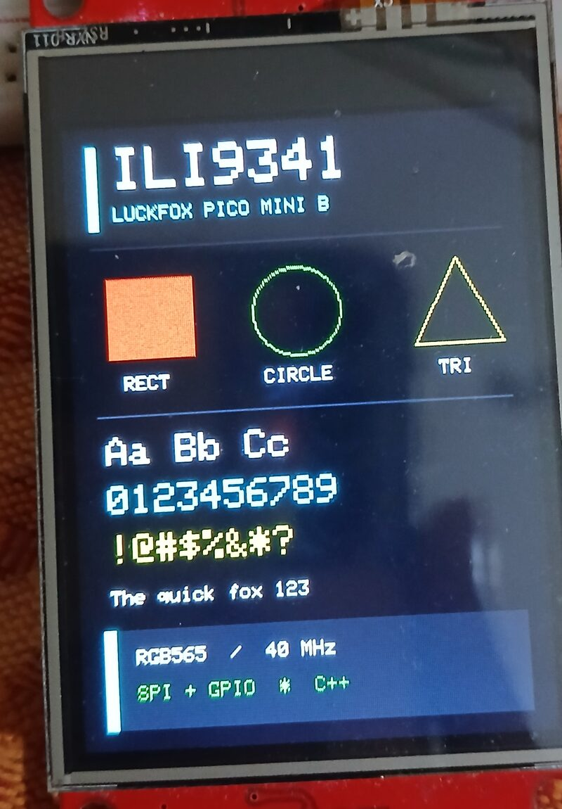

# ILI9341 for Linux SPI (Luckfox Pico Mini B)

A small C++11 driver for 240 × 320 ILI9341 SPI displays on Linux boards. It uses Linux `spidev` for SPI and the GPIO character-device API for D/C, optional reset, and optional software CS. The drawing API is inspired by [Bodmer's TFT_eSPI](https://github.com/Bodmer/TFT_eSPI), but this is a separate Linux library, not a drop-in Arduino replacement.



**Build guide:** [ILI9341 SPI Display Driver in C++ for the Luckfox Pico Mini B](https://accidentalantenna.pages.dev/projects/luckfox-ili9341-spi-display/) on [AccidentalAntenna](https://accidentalantenna.pages.dev).

Features: RGB565 pixels, lines, rectangles, images, scalable 5 × 7 ASCII text, RAM sprites, four rotations, and pixel readback. Touch is not included.

## Requirements

- A Linux board with an enabled SPI controller, `/dev/spidev*`, and `/dev/gpiochip*` (GPIO character-device v1 API).
- An SPI ILI9341 display with D/C and CS pins. Connect SDO/MISO if you need `readPixel()`.
- A C++11 compiler and `make`. Cross-compile with your board's toolchain when building on another computer.
- Permission to access the SPI and GPIO device nodes. The commands below run as root on the Luckfox image.

The display must have exclusive use of its CS line. Another SPI device can share CLK, MOSI, and MISO only when each device has a separate CS and the kernel configuration supports both devices.

## Wiring: Luckfox Pico Mini B example

These are **physical side-pad numbers** on the Pico Mini B. The rightmost column gives offsets within `/dev/gpiochip1`; those are the numbers passed to this library. Other boards and device trees can use different GPIO chips or offsets.

| ILI9341 module pin | Pico Mini B pad | Pico signal | `/dev/gpiochip1` offset |
| --- | ---: | --- | ---: |
| VCC | 3 | 3V3(OUT) | — |
| GND | 2 or 21 | GND | — |
| SCK / CLK | 7 | SPI0_CLK_M0 | — |
| DIN / SDA / MOSI | 8 | SPI0_MOSI_M0 | — |
| SDO / MISO | 9 | SPI0_MISO_M0 | — |
| CS | 13 | GPIO1_D1, software CS | 25 |
| DC / RS | 10 | GPIO1_C4 | 20 |
| RST / RESET | 16 | GPIO1_C6 | 22 |
| LED / BL | 11 | GPIO1_C5 | 21 |

Check your module's **voltage and backlight circuit** before connecting VCC or BL. The library does not control the backlight. On the tested setup, setting global GPIO 53 (GPIO1_C5) high turns it on. Use a common ground.

Pad 6 is SPI0's hardware CS0. Keep this display's CS on **pad 13** when using `readPixel()`: a software CS can stay asserted while the driver switches D/C between command and data. GPIO1_C3 on pad 9 is MISO, so use a different pad for reset. Do not swap the module's DIN/MOSI and SDO/MISO.

For a write-only setup, the display can instead use hardware CS0 on pad 6 if the device tree enables it. Pass `cs = -1`, leave SDO disconnected if it is not needed, and do not call `readPixel()`.

On your board, verify the actual device names before running:

```sh
ls /dev/spidev* /dev/gpiochip*
```

SPI0 must expose a `spidev` device, with CLK, MOSI, and MISO in SPI mode and the control pads in GPIO mode. Do not bind a framebuffer driver and `spidev` to the same SPI device.

## Build

From the repository directory, build and run the small host-side self-check:

```sh
make test
```

Build for the Luckfox Pico Mini B with the toolchain installed by the [Luckfox Pico SDK](https://github.com/LuckfoxTECH/luckfox-pico):

```sh
SDK_DIR=/path/to/luckfox-pico
make -B CXX="$SDK_DIR/tools/linux/toolchain/arm-rockchip830-linux-uclibcgnueabihf/bin/arm-rockchip830-linux-uclibcgnueabihf-g++"
```

The `-B` option rebuilds `example` even if you previously built it with a different compiler. You can also compile `ILI9341.cpp` and `Sprite.cpp` into your own C++11 application; no third-party library is required.

Copy the executable to the board, for example:

```sh
adb push example /tmp/ili9341-example
adb shell chmod +x /tmp/ili9341-example
```

## Run the example

The example takes all board-specific settings at runtime:

```text
example SPI_DEVICE GPIO_CHIP DC_LINE RESET_LINE CS_LINE [SPI_HZ]
```

| Argument | Meaning |
| --- | --- |
| `SPI_DEVICE` | Linux SPI node, such as `/dev/spidev0.0`. |
| `GPIO_CHIP` | GPIO character device containing the control lines, such as `/dev/gpiochip1`. |
| `DC_LINE` | D/C line offset **within that GPIO chip**. |
| `RESET_LINE` | Reset line offset, or `-1` if reset is held high externally. |
| `CS_LINE` | Software CS line offset, or `-1` for hardware CS. `readPixel()` requires software CS. |
| `SPI_HZ` | Optional SPI clock in hertz; the example defaults to 16,000,000. |

For the wiring table above, with reset held high separately:

```sh
/tmp/ili9341-example /dev/spidev0.0 /dev/gpiochip1 20 -1 25 40000000
```

The example uses rotation `2` (180°). It draws a black background, red rectangle, white diagonal and text, and a blue/yellow sprite. A successful read prints `pixel(105,175): 0x1f`.

### If the board boots with ESP32 SPI Wi-Fi

The [ESP32 SPI Wi-Fi project](https://github.com/pahasara2003/luckfox_esp_wifi) binds `spi0.0` to its `esp_spi` driver. **Disconnect the ESP32** before using the display on the same SPI0 wires. For a temporary test on that image, run these commands as root on the Luckfox:

```sh
echo spi0.0 > /sys/bus/spi/drivers/esp_spi/unbind
echo spidev > /sys/bus/spi/devices/spi0.0/driver_override
echo spi0.0 > /sys/bus/spi/drivers/spidev/bind

[ -d /sys/class/gpio/gpio53 ] || echo 53 > /sys/class/gpio/export
echo out > /sys/class/gpio/gpio53/direction
echo 1 > /sys/class/gpio/gpio53/value  # backlight

[ -d /sys/class/gpio/gpio54 ] || echo 54 > /sys/class/gpio/export
echo out > /sys/class/gpio/gpio54/direction
echo 1 > /sys/class/gpio/gpio54/value  # hold reset high after the program exits

/tmp/ili9341-example /dev/spidev0.0 /dev/gpiochip1 20 -1 25 40000000
```

The driver override reverts on reboot. On the tested module, releasing the reset GPIO when the program exited cleared the image; keep reset high with a pull-up or a GPIO owner when showing a static image. For an application that stays running, you can pass reset line `22` and let the `ILI9341` object own it for its lifetime.

## More examples

The [examples](examples) directory contains three small applications:

| Source | Demonstrates |
| --- | --- |
| [`basic.cpp`](examples/basic.cpp) | Screen fill, filled rectangles, a line, and text. |
| [`sprite.cpp`](examples/sprite.cpp) | Draw one RGB565 sprite in RAM, then place it on screen three times. |
| [`photo_demo.cpp`](examples/photo_demo.cpp) | A photo-ready screen with a title, rectangle, circle, triangle, text sizes, letters, numbers, symbols, and a sprite footer. |

All three read their SPI device, GPIO chip, line offsets, clock, and rotation from [`examples/board_config.h`](examples/board_config.h). Edit that one file for your board. The included values match the Pico Mini B wiring table above, use 40 MHz and rotation `2`, and expect reset to be held high separately.

Build them with the Luckfox toolchain:

```sh
SDK_DIR=/path/to/luckfox-pico
make -B examples CXX="$SDK_DIR/tools/linux/toolchain/arm-rockchip830-linux-uclibcgnueabihf/bin/arm-rockchip830-linux-uclibcgnueabihf-g++"
```

This creates `build/basic`, `build/sprite`, and `build/photo_demo`. After enabling `spidev`, the backlight, and reset as shown above, copy and run the photo demo:

```sh
adb push build/photo_demo /tmp/photo_demo
adb shell chmod +x /tmp/photo_demo
adb shell /tmp/photo_demo
```

The finished image remains on the display while reset and backlight stay high, so you can take a photograph. Run the other examples in the same way, replacing `photo_demo` with `basic` or `sprite`.

## Use in your own program

Put the board-specific values together near the start of your application. Change these values to match your wiring and Linux device nodes; the library itself has no fixed pinout.

```cpp
#include "ILI9341.h"
#include "Sprite.h"

constexpr const char* SPI_DEVICE = "/dev/spidev0.0";
constexpr const char* GPIO_CHIP = "/dev/gpiochip1";
constexpr unsigned DC_LINE = 20;
constexpr int RESET_LINE = -1; // Reset held high separately
constexpr int CS_LINE = 25;
constexpr uint32_t SPI_HZ = 40000000;

int main() {
    ILI9341 display(SPI_DEVICE, GPIO_CHIP, DC_LINE, RESET_LINE, SPI_HZ, CS_LINE);
    display.init();
    display.setRotation(2);
    display.fillScreen(ILI9341::color565(0, 0, 0));
    display.drawString(12, 12, "Hello", 0xFFFF, 0x0000, 2);

    Sprite icon(32, 32);
    icon.fillSprite(0x001F);
    icon.fillRect(8, 8, 16, 16, 0xFFE0);
    icon.pushSprite(display, 40, 50);
}
```

Save the snippet as `my_app.cpp` in this repository, then compile it with the library sources:

```sh
g++ -std=c++11 -O2 my_app.cpp ILI9341.cpp Sprite.cpp -o my_app
```

Replace `g++` with your board's cross-compiler when building on another computer. `SPI_HZ` is a requested clock, not a guarantee: start lower and check image quality and readback before increasing it.

## API reference

Coordinates use the top-left corner of the **current rotation** as `(0, 0)`. Width and height are in pixels. Colors are 16-bit RGB565; examples: black `0x0000`, white `0xFFFF`, red `0xF800`, blue `0x001F`. Drawing outside the screen is clipped. Methods that access Linux devices can throw `std::runtime_error` on an I/O error.

### `ILI9341` display

| Function | Parameters and behavior |
| --- | --- |
| `ILI9341(spi, gpiochip, dc, reset=-1, hz=16000000, cs=-1)` | Construct the driver. `spi` and `gpiochip` are device paths; `dc`, `reset`, and `cs` are line offsets within `gpiochip`. `-1` skips reset or software CS. The constructor does not open devices. |
| `init()` | Open and configure SPI/GPIO, optionally pulse reset, initialize the panel, and turn on the display. Call before drawing. Calling it again on the same object does nothing. |
| `setRotation(rotation)` | Set orientation: `0` or `2` is 240 × 320; `1` or `3` is 320 × 240. Values wrap modulo 4. |
| `width()`, `height()` | Return dimensions after the current rotation. |
| `color565(r, g, b)` | Convert 8-bit red, green, and blue channels to a 16-bit RGB565 value. |
| `drawPixel(x, y, color)` | Draw one pixel. |
| `drawFastHLine(x, y, w, color)` | Draw a horizontal line starting at `(x, y)` and extending `w` pixels right. |
| `drawFastVLine(x, y, h, color)` | Draw a vertical line starting at `(x, y)` and extending `h` pixels down. |
| `drawLine(x0, y0, x1, y1, color)` | Draw a line between two endpoints, inclusive. Adjacent pixels are grouped where possible. |
| `fillRect(x, y, w, h, color)` | Fill a rectangle from `(x, y)` with width `w` and height `h`. Nonpositive dimensions do nothing. |
| `fillScreen(color)` | Fill the whole screen. |
| `pushImage(x, y, w, h, pixels)` | Transfer a row-major array of `w × h` RGB565 `uint16_t` pixels. The caller keeps ownership of `pixels`; a null pointer or nonpositive dimensions do nothing. |
| `readPixel(x, y)` | Read one pixel in RGB565. Requires display SDO/MISO and a GPIO software CS (`cs >= 0`). Out-of-bounds coordinates return `0`; this is also a valid black pixel. |
| `drawChar(x, y, c, color, background, scale=1)` | Draw one printable ASCII character using an opaque 5 × 7 font in a 6 × 8 cell. `scale` is an integer from 1 to 8; unsupported characters or scales do nothing. |
| `drawString(x, y, text, color, background, scale=1)` | Draw printable ASCII text with the same font. `\n` starts a new line at the original `x`; each line is `8 × scale` pixels tall. Background is opaque. |

A `uint16_t` image array is in **host memory order**; `pushImage()` sends its pixels in display byte order. It does not retain the array after the call.

### `Sprite` RAM buffer

A sprite is an in-memory RGB565 image. It needs `width × height × 2` bytes for pixels, plus vector overhead. Drawing into it does not talk to SPI until `pushSprite()`.

| Function | Parameters and behavior |
| --- | --- |
| `Sprite(width, height)` | Allocate a sprite. Both dimensions must be positive; otherwise throws `std::invalid_argument`. |
| `width()`, `height()` | Return sprite dimensions. |
| `fillSprite(color)` | Set every sprite pixel to `color`. |
| `drawPixel(x, y, color)` | Set one sprite pixel; out-of-bounds coordinates do nothing. |
| `fillRect(x, y, w, h, color)` | Fill a clipped sprite rectangle; nonpositive dimensions do nothing. |
| `readPixel(x, y)` | Return a sprite pixel, or `0` if out of bounds. This reads RAM, not the display. |
| `pushSprite(display, x, y)` | Copy the entire sprite to `display` with its top-left corner at `(x, y)`. The display clips offscreen parts. |

For many small updates, draw into a sprite and push it once to reduce SPI setup overhead. `Sprite` has no transparent-color mode; every pixel in its rectangle is transferred.

## Performance and checks

On one Pico Mini B and ILI9341 module with short jumper wires, a full-screen RGB565 fill took about **128 ms at 10 MHz** and **42 ms at 40 MHz**. The optimized sample string took about **3.4 ms**, and a full diagonal about **45 ms**, at 40 MHz. Ten consecutive 40 MHz fills returned the expected blue pixel through `readPixel()`. These are short-run measurements; use a lower clock if longer wiring or another panel shows corruption.

```sh
make test
SDK_DIR=/path/to/luckfox-pico
make -B bench CXX="$SDK_DIR/tools/linux/toolchain/arm-rockchip830-linux-uclibcgnueabihf/bin/arm-rockchip830-linux-uclibcgnueabihf-g++"
# Copy bench to the board, then run: ./bench 10000000 or ./bench 40000000
```

`bench.cpp` uses the Pico Mini B offsets in the wiring table and expects reset held high externally.

## Limitations and attribution

- The font supports printable ASCII only. No Unicode, advanced TFT_eSPI fonts, antialiasing, or image decoding.
- No touch controller support, transparency in sprites, or framebuffer API.
- The initialization matches the `ILI9341_2_DRIVER` sequence used by the author's ESP32 TFT_eSPI setup. Other ILI9341 modules may need a different initialization or color-order setting.
- Display content and GPIO output state may be lost when the program exits unless reset/backlight are held appropriately.

The 5 × 7 font data comes from Adafruit GFX; see [FONT_LICENSE.txt](FONT_LICENSE.txt). The library source is released under the [MIT License](LICENSE).
